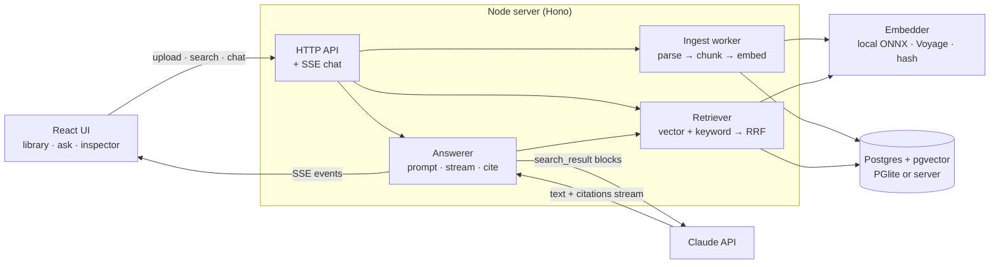

# Groundwork

Ask questions over your own documents and get answers you can verify.

Groundwork ingests Markdown, plain text, HTML and PDF files, indexes them in Postgres with pgvector, and answers questions with Claude. Every claim in an answer carries a citation that resolves to the exact sentences it came from, so you can click it and read the source. Retrieval is hybrid: vector search and Postgres full-text search, fused with Reciprocal Rank Fusion. An eval harness measures each retrieval mode on a labelled question set.

It runs locally with no API keys: an embedded Postgres (PGlite) and a local embedding model. Without an Anthropic key you still get the full retrieval pipeline and inspector; with one, you also get streamed, cited answers.

- **Ingestion**: format-aware parsing, structure-aware chunking, pluggable embedders (local ONNX model by default, Voyage AI, or a deterministic hash embedder for tests).
- **Storage**: one Postgres schema with pgvector, run either embedded (PGlite) or on a Postgres server (`DATABASE_URL`).
- **Retrieval**: vector, keyword or hybrid (RRF), with per-retriever ranks and scores exposed to the UI.
- **Answers**: Claude reads the retrieved chunks as `search_result` content blocks and returns native citations, streamed to the browser over server-sent events.
- **Eval**: 36 labelled questions over a 13-document sample corpus; Recall@k and MRR for each mode.

## Quick start

Requires Node 22+.

```bash
npm ci
npm run demo        # indexes samples/, builds, serves http://localhost:8787
```

`npm run demo` downloads the embedding model once (about 130 MB, cached in `.cache/`), ingests the sample corpus into an embedded database in `data/`, builds the server and web app, and starts one process serving both. Open http://localhost:8787 and try one of the suggested questions.

To get written answers, put a key in `.env` (see [`.env.example`](.env.example)) and restart:

```bash
echo "ANTHROPIC_API_KEY=sk-ant-..." > .env
npm start
```

Other commands:

| Command | What it does |
| --- | --- |
| `npm run dev` | API with reload on :8787 and the Vite dev server on :5173 (proxies `/api`) |
| `npm run seed` | Ingests `samples/` into the "Wayline samples" collection. Safe to re-run. Stop the server first: PGlite allows one process per data directory |
| `npm run eval` | Retrieval eval (see [Evaluation](#evaluation)) |
| `npm test` | 66 offline tests |
| `npm run typecheck` / `npm run build` | Both workspaces |

On Linux x64, `onnxruntime-node` downloads CUDA providers during install unless `ONNXRUNTIME_NODE_INSTALL=skip` is set. The app only uses the CPU build, so setting it saves a large download (CI does this).

## Architecture



What happens when you ask a question (`server/src/answer/answerer.ts`):

1. The question is stored in a conversation. A follow-up ("and how long does that take?") is first rewritten into a standalone search query by a short, low-effort Claude call, because a follow-up on its own retrieves nothing useful.
2. The retriever returns the top 8 chunks in the chosen mode. They are streamed to the UI immediately, so the inspector fills in before any answer text arrives.
3. If retrieval is clearly empty, the answerer replies "I couldn't find this in your documents" without calling the model (see [Not-found short-circuit](#not-found-short-circuit)).
4. Otherwise each chunk becomes a citable `search_result` block and Claude's answer streams back as text and citation events, which are resolved to chunk ids and character offsets, forwarded to the browser and persisted with the message.

All dependencies on the outside world (database, embedder, LLM client) are injected in one place (`server/src/services.ts`), which is how the tests run the real service graph with an in-memory database, a hash embedder and a scripted LLM.

### Repository layout

```
server/
  migrations/001_init.sql   schema (plain SQL, applied in order)
  src/
    app.ts                  HTTP routes (Hono), validation (zod), SSE
    services.ts runtime.ts  dependency wiring
    db/                     PGlite / node-postgres behind one interface, migrations, embedder pinning
    ingest/                 parse.ts (per format), chunker.ts, service.ts (queue + indexing)
    embeddings/             local.ts (transformers.js / ONNX), voyage.ts, hash.ts
    retrieval/              retriever.ts (vector, keyword, hybrid), rrf.ts
    answer/                 answerer.ts, prompt.ts, citations.ts, llm.ts (Anthropic SDK seam)
    eval/                   run.ts, dataset.ts, metrics.ts, answers.ts
    scripts/                seed.ts
  test/                     vitest suites and helpers (fake LLM, PDF writer)
web/src/                    React + Vite UI
samples/                    sample corpus (fictional, written for this repo)
eval/                       questions.json and results/
```

## Ingestion

**Parsing** (`ingest/parse.ts`) turns every format into a title plus a list of sections, each with a heading path and optional page number:

- **Markdown** is split at headings; `#` lines inside fenced code blocks are ignored. Each section keeps its full path, e.g. `Wayline On-Call Runbook > Common alerts > WL-ALERT-QLAG`.
- **HTML** is converted to Markdown with Turndown (scripts, styles, nav, footer and the `<title>` element removed) and then parsed as Markdown, so headings become sections the same way.
- **PDF** is read page by page with pdf.js (via unpdf). PDF text is stored as positioned lines with a hard break at the end of every visual line, so the parser rebuilds paragraphs from the vertical gaps between lines. Without that step, sentences were cut at every line wrap, which broke both chunking and citations. The title comes from the PDF metadata when present. Each page is one section, so citations can name the page.
- **Plain text** is one section.

**Chunking** (`ingest/chunker.ts`) is structure-aware: a chunk never spans two sections, so every chunk has exactly one heading path and page. Within a section, paragraphs are packed up to 1,200 characters (about 300 tokens); an oversize paragraph falls back to sentences, then words; code fences stay whole. Consecutive chunks of a section overlap by up to 200 characters of *whole sentences*, never fragments.

**Embedding** uses a contextual header: what gets embedded is `title > heading path` plus the chunk text, so a chunk that says "set it to 2000" still lands near questions about the setting its heading names. The stored chunk text stays clean for display and citations.

**Processing** is asynchronous: an upload is hashed, de-duplicated per collection by SHA-256, inserted as `queued`, and handed to a single in-process worker. One worker is deliberate, because local embedding is CPU-bound and parallel jobs would only compete for it. The queue lives in memory, so on boot any document still `queued` or `processing` is marked failed with a message asking for a re-upload, instead of staying stuck.

## Schema and indexes

`server/migrations/001_init.sql`, applied by a small migration runner that records applied files in `schema_migrations` and runs each file in a transaction.

| Table | Purpose |
| --- | --- |
| `collections` | A named set of documents; every query is scoped to one |
| `documents` | One uploaded file: status (`queued` / `processing` / `ready` / `failed`), error, SHA-256, chunk count |
| `chunks` | Chunk text, heading path, page, `embedding vector(N)`, and a generated `tsv tsvector` |
| `conversations`, `messages` | Chat history; assistant messages store the answer segments with resolved citations and the retrieval snapshot they cite (`jsonb`) |
| `embedding_config` | A single row recording which embedder built the index |

Index choices:

- **`hnsw (embedding vector_cosine_ops)`** for vector search. HNSW gives good recall without a training step; IVFFlat needs representative data at build time and list tuning, which doesn't suit a database that starts empty and grows one upload at a time. Embeddings are L2-normalised, so cosine distance (`<=>`) is the natural metric.
- **Iterative index scans.** HNSW applies the `collection_id` filter after walking the graph, so a selective filter can return fewer than `k` rows. The vector query sets `hnsw.iterative_scan = strict_order` (pgvector 0.8+) for its transaction so the scan keeps going until enough rows pass the filter. PGlite here ships pgvector 0.8.7; a server Postgres needs pgvector 0.8 or later.
- **`gin (tsv)`** for keyword search. `tsv` is a stored generated column, `setweight(section, 'A') || setweight(content, 'B')`, so headings outweigh body text and the text is parsed once at write time, not per query.
- **B-trees** that match the access paths: `chunks (collection_id)`, `chunks (document_id, ordinal)`, `documents (collection_id, created_at DESC)` for the library list, and `messages (conversation_id, created_at)`.
- **`UNIQUE (collection_id, sha256)`** on documents enforces de-duplication in the database rather than only in application code. Foreign keys cascade, so deleting a document or collection removes its chunks and history.

**Embedder pinning.** Vectors from different models live in different spaces; mixing them in one index silently ruins search. The vector dimension is substituted into the migration on first run, and `embedding_config` records the embedder id (for example `local:Xenova/bge-small-en-v1.5`) and dimension. On every boot the configured embedder is compared with the pinned one, and a mismatch stops the server with an explanation instead of quietly corrupting results.

**Two database modes, one SQL dialect.** `db/client.ts` exposes the same small interface (`query`, `exec`, `transaction`) over PGlite (Postgres 18 compiled to WebAssembly, in-process, with pgvector) and over node-postgres for a real server. All SQL is shared. The test suite and eval run on PGlite; the `DATABASE_URL` path uses identical queries but was not run against a Postgres server during development (the machine used had no pgvector-enabled server).

## Retrieval

Three modes (`retrieval/retriever.ts`), each returning chunks with their final rank and the rank and raw score from each retriever:

- **Vector**: cosine similarity over the HNSW index, top 30 candidates.
- **Keyword**: Postgres full-text search, `websearch_to_tsquery('english', …)` ranked by `ts_rank_cd`, top 30 candidates. Every term must match by default, and users get search-engine syntax (`"quoted phrase"`, `OR`, `-exclude`). Ties, which are common with `ts_rank_cd`, are broken by chunk length and then content, so results are reproducible; chunk ids are random, and ordering by them made the eval vary between runs.
- **Hybrid**: both candidate lists fused with Reciprocal Rank Fusion (`retrieval/rrf.ts`), then cut to `k`.

**Why RRF.** RRF scores each chunk as `Σ 1 / (60 + rank)` over the lists it appears in. It uses ranks only, which matters here because the two retrievers' scores are not comparable: cosine similarity and `ts_rank_cd` live on unrelated scales, and normalising them is fragile. RRF needs no tuning beyond the constant (60, from Cormack et al., 2009), and a chunk that both retrievers find rises above one that only a single retriever ranks first. Each list is 30 deep so fusion can rescue a chunk one retriever ranks low.

**All terms or any term.** The eval exposed a real trade-off in keyword matching, so it is configurable (`KEYWORD_MATCH=all|any`) and both settings are measured below. Requiring every term is precise but finds nothing for a natural-language question containing one word the document doesn't use. OR-ing the terms finds far more, but Postgres ranking has no IDF: a chunk that repeats "time" or "week" scores like one that contains a rare error code. In hybrid mode RRF gives that noisy list an equal vote, and the measured result was worse hybrid ranking. All-terms stays the default.

## Answers and citations

The answerer (`answer/`) uses the Anthropic TypeScript SDK with `claude-opus-5-5` by default (`ANTHROPIC_MODEL` overrides it), adaptive thinking, effort `medium` (`ANTHROPIC_EFFORT`), and streaming.

**Citations come from the API, not from parsing model output.** Each retrieved chunk is sent as a `search_result` content block with citations enabled, and the question follows as a text block. Claude cites whole content blocks, never substrings, so the chunk is split into one text block per sentence (`citations.ts`). That gives sentence-level citations, and because each block's character offsets in the chunk are recorded, a `search_result_location` citation (`search_result_index`, `start_block_index`, `end_block_index`) maps back to an exact span of an exact chunk. The UI highlights that span when you click a citation marker. Numbered headings ("1. Purpose and scope") are kept as one block so a citation can't land on a bare number.

**Streaming.** `POST /api/collections/:id/chat` returns server-sent events: `conversation`, optionally `query` (the rewritten follow-up), `retrieval` (the chunks with scores), then `segment` / `text` / `citation` as the answer streams, `notice` for refusals, truncation or a model fallback, and finally `done` with the model and token usage, or `error` with a message that is safe to show. The browser reads the stream with `fetch`, because `EventSource` only supports GET.

**Prompting.** The system prompt (`prompt.ts`) restricts answers to the passages, asks Claude to say plainly when the documents only partly answer, and defines an exact "I couldn't find this in your documents." reply. Earlier turns are replayed as plain text without their citations, so `search_result_index` in a response always refers to the current turn's retrieval.

**Failure handling.** `stop_reason: "refusal"` and `max_tokens` become notices. Requests opt into the API's server-side fallback (`fallbacks: "default"`), so a policy decline can be completed by a fallback model and the UI says so. SDK errors are mapped to readable messages (bad key, rate limit, connection) instead of raw exceptions.

**Without an API key** the answerer still retrieves, streams the `retrieval` event, and sends a notice explaining that answer generation is off. The UI says so up front, labels the button "Retrieve", and the inspector works as usual.

### Not-found short-circuit

If no chunk matched the keyword search and the best vector similarity is below `MIN_VECTOR_SIMILARITY` (0.55), the answerer returns the not-found reply without calling the model. The default was checked against bge-small on the sample corpus: off-topic questions ("What is the capital of France?", "How do I bake sourdough bread?") scored 0.47 to 0.53, while the lowest-scoring answerable eval question scored 0.554. So the shortcut only skips clearly unrelated questions. In-domain questions the documents can't answer ("How many vacation days do engineers get?" scored 0.72) can't be separated by similarity; for those the system prompt's not-found instruction applies. The threshold depends on the embedding model.

### What has and hasn't been verified

The answer path is covered by tests that use a scripted client replaying SDK-shaped stream events (`test/helpers/fake-llm.ts`): text and citation deltas, refusals, truncation, mid-stream errors and follow-up rewriting. It has not been run against the live Claude API as part of this repository's checks, because no API key was available while it was built. The optional `npm run eval -- --answers` grading likewise only runs with a key.

## Evaluation

`npm run eval` indexes `samples/` into a throwaway in-memory database through the normal ingest path, asks every question in [`eval/questions.json`](eval/questions.json) in each mode, prints the tables below and saves per-question results to `eval/results/<embedder>.json`. It needs no API key and runs offline once the model is cached.

**Corpus.** 13 short documents about a fictional company and its webhook product, in Markdown, HTML, text and PDF (see [`samples/README.md`](samples/README.md)). They were written for this project to share vocabulary across documents ("rotation", "retention", "limit"), to contain exact identifiers (`WL-4291`, `db.pool.acquire_timeout_ms`, `SEC-06`), and to word some facts differently from how people ask about them.

**Questions.** 36 questions: 16 *exact-term* (they hinge on an identifier, code or acronym) and 20 *paraphrased* (worded away from the source, e.g. "How long do we keep database backups?" against a policy that only says "restore points … kept for 35 days").

**Labels and metrics.** Each question lists one or more passages that answer it, as (document, text) pairs. A retrieved chunk is relevant if it comes from that document and contains that text. Labelling passages instead of chunk ids keeps the labels valid when chunking changes, and the runner refuses to score if any label matches no indexed chunk. Each question has exactly one fact to find, so the metrics are computed from the rank of the first relevant chunk in the top 10: **Recall@k** is the share of questions with a relevant chunk in the top k, and **MRR@10** is the mean reciprocal of that rank.

### Results

Local model, default settings (`npm run eval`), output as printed:

```
Corpus: 13 documents from samples/ (72 chunks), indexed in 1.9 s
Questions: 36 (16 exact-term, 20 paraphrased) from eval/questions.json
Embedder: local:Xenova/bge-small-en-v1.5 (384d) · Keyword match: all terms · Database: pglite · Depth: top 10
```

| Mode | Recall@1 | Recall@3 | Recall@5 | Recall@10 | MRR@10 | Mean latency |
| --- | ---: | ---: | ---: | ---: | ---: | ---: |
| vector | 0.83 | 0.92 | 0.94 | 0.97 | 0.88 | 8.4 ms |
| keyword | 0.17 | 0.22 | 0.22 | 0.22 | 0.19 | 0.5 ms |
| hybrid | 0.89 | 0.97 | 0.97 | 1.00 | 0.93 | 8.6 ms |

| Mode | Exact: Recall@5 | Exact: MRR | Paraphrased: Recall@5 | Paraphrased: MRR |
| --- | ---: | ---: | ---: | ---: |
| vector | 0.94 | 0.81 | 0.95 | 0.93 |
| keyword | 0.50 | 0.44 | 0.00 | 0.00 |
| hybrid | 1.00 | 0.93 | 0.95 | 0.93 |

```
Hybrid misses (no relevant chunk in the top 5): 
- p12 "What happens to my webhook URL if my server has been down for a week?": first relevant at rank 7; top hit postmortem-pm-2026-014.pdf § p. 1
```

Latency is the mean per query on a laptop (Apple Silicon, PGlite in-process), including embedding the query.

**Reading the results.**

- **Hybrid is best on every overall metric**, but the gain comes entirely from exact-term questions: there it lifts Recall@5 from 0.94 to 1.00 and MRR from 0.81 to 0.93. Three questions moved. "What is action item ACT-113?" went from vector rank 5 to 1, "What was fixed in 3.5.1?" from 3 to 1, and "What is our RTO?", which vector search didn't find in its top 10 at all, came in at rank 3. Embeddings handle identifiers and acronyms poorly; an exact keyword match fixes that.
- **On paraphrased questions hybrid does not win; it ties vector exactly.** All-terms keyword search matched nothing for any of the 20 paraphrased questions, so RRF passed the vector list through unchanged. That's the intended behaviour of a precise keyword leg, but it means hybrid adds nothing there.
- **Keyword search alone is weak** (Recall@5 0.22) because of the all-terms rule. Even exact-term questions fail when they contain a word the document doesn't, e.g. "What does SEC-06 *require*?".
- **The remaining miss** is a true paraphrase gap: "webhook URL … down for a week" against an FAQ entry about an "endpoint" that "failed for five consecutive days".

**Any-term keyword matching** (`KEYWORD_MATCH=any npm run eval`), same corpus and questions:

```
Embedder: local:Xenova/bge-small-en-v1.5 (384d) · Keyword match: any terms · Database: pglite · Depth: top 10
```

| Mode | Recall@1 | Recall@3 | Recall@5 | Recall@10 | MRR@10 | Mean latency |
| --- | ---: | ---: | ---: | ---: | ---: | ---: |
| vector | 0.83 | 0.92 | 0.94 | 0.97 | 0.88 | 8.2 ms |
| keyword | 0.58 | 0.78 | 0.81 | 0.83 | 0.68 | 1.4 ms |
| hybrid | 0.75 | 0.89 | 0.97 | 1.00 | 0.82 | 8.5 ms |

| Mode | Exact: Recall@5 | Exact: MRR | Paraphrased: Recall@5 | Paraphrased: MRR |
| --- | ---: | ---: | ---: | ---: |
| vector | 0.94 | 0.81 | 0.95 | 0.93 |
| keyword | 1.00 | 0.88 | 0.65 | 0.51 |
| hybrid | 1.00 | 0.93 | 0.95 | 0.74 |

Keyword search on its own improves sharply (Recall@5 0.22 → 0.81, and it beats vector on exact terms), but **hybrid gets worse**: Recall@1 drops from 0.89 to 0.75 and paraphrased MRR from 0.93 to 0.74. For paraphrased questions the OR query ranks chunks by common words, and RRF gives that list as much weight as the much better vector list. This is why all-terms is the default. A keyword ranker with IDF (BM25) or a weighted fusion tuned on held-out questions are the obvious next experiments.

**CI** runs the same eval with the hash embedder (`EMBEDDER=hash`), which needs no download. It checks the pipeline end to end; its scores (hybrid Recall@5 0.53) only reflect lexical overlap and are not meant as a quality signal. Results for all three runs are in `eval/results/`.

**Caveats.** This is a small, self-written benchmark: 72 chunks is an easy search space, and the same person wrote the documents and the questions, which flatters every mode. Treat the numbers as a regression check and a way to compare configurations, not as a claim about real-world accuracy.

**Answer grading** (`npm run eval -- --answers`, needs `ANTHROPIC_API_KEY`) runs every question through the full answer pipeline and grades citations mechanically: how many questions were answered, answered with citations, and cited a chunk containing a gold passage, plus citation precision at the document level. It doesn't judge the prose. Without a key it prints that it was skipped. It has not been run for this README.

## Testing

```bash
npm test
```

66 vitest tests in `server/test/`, all offline. They run the real service graph and real SQL on an in-memory PGlite database, with the hash embedder and a scripted LLM:

- **Parsing**: type detection, Markdown heading paths and code fences, HTML clean-up, PDF paragraph rebuilding (wrapped lines, hyphenation, columns, pages with no wrapped lines), PDF titles.
- **Chunking**: size limits, section boundaries, whole-sentence overlap, oversize paragraphs and sentences, code fences.
- **RRF**: the formula, fusion order, empty lists, the effect of `k`.
- **Retrieval**: each mode's ranks and scores, all-terms vs any-term matching, collection isolation, `k`, and the embedder-mismatch guard.
- **Citations**: sentence blocks and their offsets, citation-to-chunk mapping, out-of-range citations, the `search_result` payload.
- **Answerer**: no-key mode, streamed answer with resolved and persisted citations, the request sent to the model, the not-found short-circuit, refusal, truncation, mid-stream API errors, follow-up rewriting, cross-collection access.
- **HTTP API** via `app.request`: health, collections, multipart upload with background processing and de-duplication, unsupported files, search per mode, SSE chat, conversations, deletes, error responses.
- **Eval**: metrics, relevance matching, dataset validation, answer grading.

**CI** (`.github/workflows/ci.yml`, Node 22): `npm ci`, typecheck, tests, build, then the hash-embedder eval.

## API

| Method | Path | |
| --- | --- | --- |
| GET | `/api/health` | Database, embedder, whether answers are enabled, retrieval settings |
| GET / POST | `/api/collections` | List / create (`{ name, description? }`) |
| DELETE | `/api/collections/:id` | Delete with all documents and conversations |
| GET | `/api/collections/:id/documents` | List documents with status |
| POST | `/api/collections/:id/documents` | Multipart upload, one or more `file` fields (25 MB limit). Returns 202; processing is asynchronous |
| POST | `/api/collections/:id/documents/url` | Fetch and ingest a page (`{ url }`) |
| GET / DELETE | `/api/documents/:id` | Read / delete one document |
| POST | `/api/collections/:id/search` | `{ query, mode?, k? }` → ranked chunks with per-retriever ranks and scores |
| POST | `/api/collections/:id/chat` | `{ message, conversationId?, mode? }` → SSE stream (see above) |
| GET | `/api/collections/:id/conversations` | Conversations in a collection |
| GET | `/api/conversations/:id/messages` | Messages, with stored citations and retrieval snapshots |

## Configuration

All settings are environment variables, optionally in a root `.env`; [`.env.example`](.env.example) lists them with defaults. The main ones: `ANTHROPIC_API_KEY`, `ANTHROPIC_MODEL`, `ANTHROPIC_EFFORT`, `DATABASE_URL`, `EMBEDDER` (`local` | `voyage` | `hash`), `RETRIEVAL_TOP_K`, `KEYWORD_MATCH`, `MIN_VECTOR_SIMILARITY`.

## Limitations and next steps

- **Keyword ranking has no IDF.** `ts_rank_cd` counts term occurrences, which is why any-term matching hurt hybrid results. BM25 inside Postgres (for example the `pg_search` extension) would be the next experiment, along with weighted RRF tuned on held-out questions.
- **No reranker.** A cross-encoder over the fused top 30 is the usual next step for precision at rank 1.
- **The eval is small and self-written.** It needs real questions from real users, and a held-out split before any parameter is tuned on it.
- **Answers are untested against the live API** in this repository (see above), and answer grading is mechanical, not a judgement of correctness.
- **Single-process job queue.** Ingestion jobs live in memory, so they don't survive a restart (they're marked failed) and don't scale past one instance. A jobs table claimed with `FOR UPDATE SKIP LOCKED` would fix both.
- **PGlite is single-process**, so the seed script and the server can't share a data directory at the same time.
- **PDFs**: no OCR for scanned files, and sections are pages rather than detected headings.
- **Not ready to deploy as-is**: there is no authentication, and the URL-ingest endpoint fetches any http(s) URL from the server, which would need an allow-list or private-network blocking (SSRF) before exposure.
- **Untested paths**: the Voyage embedder and the `DATABASE_URL` (server Postgres) mode share their interfaces with the tested paths, but neither was run during development.
- Full-text search uses the `english` configuration; other languages would need their own.
- The UI keeps the current conversation in memory; stored conversations are available through the API but not listed in the UI yet.

## License

MIT, see [LICENSE](LICENSE). The sample documents are fictional and covered by the same license.
